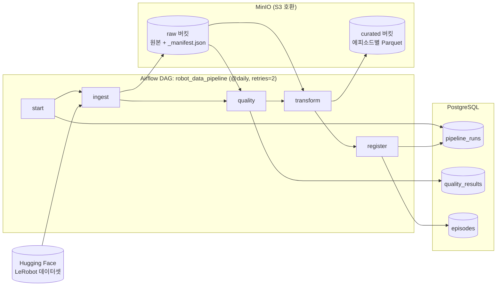

# Robot Data Pipeline

공개 로봇 시연 데이터(LeRobot)를 **수집 → 품질 검사 → 학습용 변환 → 카탈로그 등록**하는 작은 데이터 파이프라인입니다.
MinIO(S3 호환), PostgreSQL, Airflow를 Docker Compose 하나로 띄워 로컬에서 그대로 재현할 수 있습니다.

> 목표는 "큰 시스템"이 아니라, **각 설계 결정의 이유를 설명할 수 있는 파이프라인**입니다.

---

## 아키텍처



| 단계 | 하는 일 | 결과 |
|---|---|---|
| **ingest** | HF 데이터셋의 표 데이터(`data/`, `meta/`)를 버전(커밋 해시)별로 수집 | `raw/{dataset}/{rev}/…` |
| **quality** | 에피소드 단위 4개 검사 → `pass` / `warn` / `fail` 판정 | `quality_results` 테이블 |
| **transform** | `fail`이 아닌 에피소드만, 배열 컬럼을 관절별 컬럼으로 펼쳐 Parquet 저장 | `curated/{dataset}/{rev}/episode_*.parquet` |
| **register** | 에피소드 카탈로그 갱신 (길이, 원본·학습 파일 위치, 품질 결과) | `episodes` 테이블 |

---

## 기술 스택

| 구성 | 선택 | 이유 |
|---|---|---|
| 오브젝트 스토리지 | **MinIO** | S3 API 호환. 클라우드(S3)와 온프레미스를 함께 쓰는 환경을 로컬에서 같은 코드로 재현 (`boto3` endpoint만 교체) |
| 메타데이터 DB | **PostgreSQL 16** | 품질 결과·에피소드 카탈로그처럼 조회·조인이 필요한 정형 데이터 |
| 오케스트레이션 | **Airflow 3.3** (LocalExecutor) | 스케줄링, 재시도, 실패 기록, 실행 이력 UI |
| 실행 환경 | **Docker Compose** | 서비스 9개(1회용 init 포함)를 명령어 하나로 실행 |
| 데이터 처리 | Python, pandas, pyarrow | |
| 데이터 | `lerobot/aloha_sim_insertion_human` 외 | 양팔 로봇 14관절, 50fps, 50 에피소드 (영상 제외 약 3MB) |

---

## 빠른 시작

**요구사항**: Docker Desktop (메모리 4GB 이상 할당), [uv](https://docs.astral.sh/uv/) (로컬 실행 시)

```bash
cp .env.example .env              # 접속 정보 (필요하면 비밀번호 수정)
docker compose up -d              # PostgreSQL, MinIO, Airflow 실행 (첫 실행 1~2분)
```

| 서비스 | 주소 | 계정 |
|---|---|---|
| Airflow UI | http://localhost:8088 | `airflow` / `airflow` |
| MinIO 콘솔 | http://localhost:9001 | `.env`의 `MINIO_ROOT_USER` / `MINIO_ROOT_PASSWORD` |
| PostgreSQL | `localhost:5433` | `.env`의 `POSTGRES_USER` / `POSTGRES_PASSWORD` |

**Airflow로 실행**: UI에서 `robot_data_pipeline` 활성화 → *Trigger* (아래 파라미터 변경 가능)

| 파라미터 | 기본값 | 설명 |
|---|---|---|
| `repo_id` | `lerobot/aloha_sim_insertion_human` | 다른 LeRobot v3.0 데이터셋도 가능 (예: `lerobot/pusht`) |
| `inject_faults` | `false` | 결함을 주입한 `-dirty` 버전으로 처리 |
| `fail_first_try` | `false` | ingest 첫 시도를 일부러 실패시켜 재시도 동작 확인 |

**Airflow 없이 실행** (같은 함수를 직접 호출):

```bash
uv sync
uv run python -m pipeline.run                          # 원본
uv run python -m pipeline.run --inject-faults          # 결함 주입 버전
uv run python -m pipeline.run --repo-id lerobot/pusht  # 다른 데이터셋
```

**결과 조회 예시**:

```sql
-- 학습에 쓸 수 있는 에피소드와 파일 위치
SELECT episode_index, n_frames, curated_key, warnings
FROM episodes
WHERE dataset = 'aloha_sim_insertion_human-dirty' AND quality_passed;

-- 제외된 에피소드와 이유
SELECT episode_index, failed_checks FROM episodes WHERE NOT quality_passed;
```

---

## 저장 구조

```
raw/                                     ← 받은 그대로 (규칙이 바뀌어도 여기서 다시 처리)
  aloha_sim_insertion_human/cc571a3c/
    data/chunk-000/file-000.parquet …
    meta/info.json, stats.json, episodes/…, tasks.parquet
    _manifest.json                       ← 업로드 완료 표시 (마지막에 기록)

curated/                                 ← 학습용
  aloha_sim_insertion_human/cc571a3c/
    episode_000000.parquet …             ← 에피소드 1개 = 파일 1개, 관절별 컬럼 28개(state 14 + action 14)
```

| 테이블 | 단위 | 용도 |
|---|---|---|
| `pipeline_runs` | 실행 1회 | 언제, 어떤 데이터셋 버전을, 성공/실패(에러 메시지) |
| `quality_results` | 에피소드 × 검사항목 | 검사별 측정값, 기준, 판정. 실행마다 쌓여 품질 추이 추적 가능 |
| `episodes` | 에피소드 | 학습 데이터 카탈로그. `quality_passed`, `curated_key`로 바로 조회 |

스키마: [`sql/schema.sql`](sql/schema.sql)

---

## 품질 검사

| 검사 | 잡으려는 문제 | warn | fail |
|---|---|---|---|
| `episode_length` | 수집 중단, 녹화 미종료 | 중앙값의 50~150% 밖 | 중앙값의 25% 미만 / 300% 초과 |
| `missing_values` | 센서 값 유실 | | NaN 1개 이상 |
| `timestamp_gap` | 전송 중 프레임 누락 | | 간격 > 1.5 / fps, 또는 역행 |
| `joint_range` | 센서 노이즈, 값 튐 | | 기준 범위(±10% 여유) 이탈 1개 이상 |

- **fail**: curated에서 제외. **warn**: 포함하되 `episodes.warnings`에 기록
- 기준값은 [`pipeline/quality.py`](pipeline/quality.py) 상단 한곳에 모아둠

### 결함 주입으로 검사 로직 검증

공개 데이터셋은 이미 정제돼 있어서 원본에 검사를 돌리면 **아무것도 걸리지 않습니다** (50/50 통과).
이 상태로는 검사가 맞아서 통과한 건지, 원래 아무것도 못 잡는 건지 구분할 수 없어서, 고정된 위치에 결함을 넣은 `-dirty` 버전을 만들었습니다 ([`pipeline/faults.py`](pipeline/faults.py)).

| 에피소드 | 주입한 결함 | 판정 |
|---|---|---|
| 3 | 중간 20프레임 삭제 | `timestamp_gap` fail |
| 7 | 100프레임 이후 잘림 (500 → 100) | `episode_length` fail |
| 12 | 관절값 5개 NaN | `missing_values` fail |
| 20 | 한 프레임 관절값 9.9 (정상 최대 1.3) | `joint_range` fail |

이 과정에서 **검사마다 사각지대가 있다**는 걸 확인했습니다.
- 끝이 잘린 에피소드는 중간 간격이 정상이라 `timestamp_gap`에 걸리지 않음 → `episode_length`가 필요
- NaN은 어떤 비교 연산도 False라서 `joint_range`를 통과함 → `missing_values`가 필요

그래서 검사 하나에 기대지 않고, 서로의 빈틈을 메우도록 4개를 함께 둡니다.

### 실행 결과

| 데이터셋 | 에피소드 | 사용 가능 (그중 warn) | 제외 |
|---|---|---|---|
| aloha_sim_insertion_human | 50 | 50 (0) | 0 |
| aloha_sim_insertion_human-dirty | 50 | 46 (0) | 4 |
| pusht | 206 | 206 (17) | 0 |

---

## 설계 결정

**1. 품질 기준은 정책이다 → pass / warn / fail 3단계**
처음엔 통과/실패 2단계였습니다. `pusht`에 돌려보니 길이 기준(중앙값의 50~150%)이 **정상 시연 17개(49~246프레임)를 탈락**시켰습니다. 시연 길이가 다른 건 결함이 아니라 데이터의 다양성일 수 있고, 이걸 버리면 학습 데이터 분포가 좁아집니다.
그래서 "망가진 데이터(fail)"와 "확인이 필요한 데이터(warn)"를 나눴습니다. 단, 길이를 warn으로만 두면 잘린 에피소드(ep7, 중앙값의 20%)도 통과하므로 길이에는 두 단계 기준을 뒀습니다.

**2. 관절 범위 기준은 검사 대상이 아니라 원본 메타에서**
검사할 데이터로 min/max를 계산하면, 튄 값(9.9)이 기준 범위 자체를 넓혀 이상치를 못 잡습니다. 데이터셋과 함께 배포된 `meta/stats.json`을 기준으로 씁니다. (실제 현장이라면 로봇 제조사의 관절 한계 스펙을 쓰는 게 맞습니다.)

**3. 태스크 사이엔 데이터가 아니라 위치만 전달**
Airflow 태스크는 서로 다른 프로세스에서 실행되고, 태스크 간 전달값(XCom)은 메타DB에 JSON으로 저장됩니다. DataFrame을 넘기지 않고 MinIO 경로와 에피소드 번호 목록만 넘기며, 각 태스크가 MinIO에서 직접 읽습니다.

**4. 몇 번을 다시 실행해도 같은 결과 (멱등성)**
재시도가 기본인 파이프라인에서 "두 번 실행됐을 때 중복·잔여물이 생기는가"를 단계마다 막았습니다.
- ingest: 모든 파일을 올린 뒤 **마지막에** `_manifest.json`을 씀. manifest가 있으면 건너뛰고, 없으면(중간 실패) 처음부터 다시 업로드
- quality: 같은 `run_id`의 결과를 지우고 다시 씀
- transform: 쓰기 전에 대상 경로를 비움 → 지난번엔 통과했다가 이번에 fail된 에피소드 파일이 남지 않음
- register: `INSERT … ON CONFLICT DO UPDATE` (upsert)

**5. 원본은 버전별로 보존**
raw 경로에 HF 데이터셋 커밋 해시를 넣어, 원본이 업데이트돼도 예전 버전이 남고 "어느 버전으로 학습했는지" 추적할 수 있습니다. 매일 실행돼도 버전이 같으면 수집은 건너뜁니다.

**6. 로직은 DAG 밖에**
DAG 파일([`dags/robot_data_pipeline.py`](dags/robot_data_pipeline.py))은 순서·스케줄·재시도만 정의하고, 로직은 [`pipeline/run.py`](pipeline/run.py)의 `step_*` 함수에 있습니다. Airflow 없이 CLI로 같은 함수를 실행해 테스트할 수 있고, 다른 오케스트레이터로 옮기기도 쉽습니다.

**7. 컬럼 이름을 하드코딩하지 않음**
fps, 관절 이름은 데이터셋의 `meta/info.json`에서 읽습니다. 그래서 코드 수정 없이 `pusht`(2축, 10fps)에도 그대로 동작했습니다.

**8. Airflow 공식 구성을 규모에 맞게 축소**
공식 docker-compose는 CeleryExecutor + Redis + Worker + Flower 구성입니다. 단일 머신·소규모 데이터에는 과해서 **LocalExecutor**로 바꾸고 Redis/Worker/Flower/Triggerer를 뺐습니다. Airflow 메타DB는 데이터 DB와 분리해 Airflow 초기화·업그레이드가 데이터에 영향을 주지 않게 했습니다. 필요한 패키지가 공식 이미지에 모두 있어 커스텀 이미지는 만들지 않았습니다(추가 설치 시 Airflow 의존성 충돌 위험).

---

## 트러블슈팅

| 문제 | 원인 | 해결 |
|---|---|---|
| `pull access denied for minio/minio` | MinIO가 2026년 9월 Docker Hub의 `minio/minio`, `minio/mc` 이미지를 삭제. 대안으로 쓰이던 quay.io도 익명 접근 시 401 | Chainguard가 배포하는 MinIO 빌드 사용, **digest(`@sha256:…`)로 고정**해 언제 받아도 같은 이미지 |
| 버킷 생성 컨테이너에서 셸 스크립트 실행 불가 | Chainguard 이미지는 셸이 없는 최소 이미지 | `MC_HOST_<alias>` 환경변수로 접속 정보를 주고 `mc mb --ignore-existing` 단일 명령으로 생성 |
| PostgreSQL `port 5432 already in use` | 호스트에 직접 설치된 PostgreSQL이 5432 사용 중 | 호스트 포트만 5433으로 매핑. 컨테이너 간 통신은 그대로 `postgres:5432` |
| Airflow 태스크 간 에피소드 번호가 문자열로 바뀜 | XCom은 JSON 직렬화 → dict의 정수 키가 문자열이 됨 | dict 대신 `[[episode, …], …]` 리스트로 반환 |
| 노트북에서 `ModuleNotFoundError` | VSCode가 프로젝트 가상환경(`.venv`)이 아닌 시스템 Python 커널 사용 | 커널을 `.venv`로 선택, 워크스페이스 기본 인터프리터 지정 |

---

## 한계와 다음 단계

- **영상 미처리**: 현재는 관절·행동 표 데이터만 다룹니다. 영상은 프레임 수·타임스탬프 정합성 검사 대상으로 확장 가능
- **테스트 코드 부재**: 결함 주입으로 검사 로직을 검증했지만 자동화된 단위 테스트(pytest)는 아직 없음
- **전체 재처리**: 매 실행마다 해당 버전 전체를 다시 검사·변환. 데이터가 커지면 새 에피소드만 처리하는 증분 처리가 필요
- **단일 노드**: LocalExecutor 기반. 규모가 커지면 KubernetesExecutor(EKS) 등으로 전환
- **변경 데이터 수집·메타데이터 관리**: 운영 DB 변경을 실시간으로 받는 CDC(Debezium), 데이터 계보 관리(DataHub)는 다음 학습 과제

---

## 폴더 구조

```
.
├── docker-compose.yml        # PostgreSQL, MinIO, Airflow 전체 구성 (줄별 주석)
├── .env.example              # 접속 정보 견본
├── dags/
│   └── robot_data_pipeline.py
├── pipeline/
│   ├── config.py             # 환경변수 로드
│   ├── storage.py            # MinIO(S3) 입출력
│   ├── db.py                 # PostgreSQL 입출력
│   ├── ingest.py             # ① 수집
│   ├── faults.py             #    결함 주입 (검증용)
│   ├── quality.py            # ② 품질 검사 + 품질 정책
│   ├── transform.py          # ③ 학습용 변환
│   └── run.py                # 단계 함수 + ④ 카탈로그 등록 + CLI
├── sql/schema.sql
└── notebooks/
    └── 01_explore_dataset.ipynb   # 데이터셋 구조 파악, 결함 주입 실험
```
